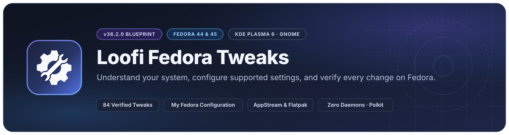
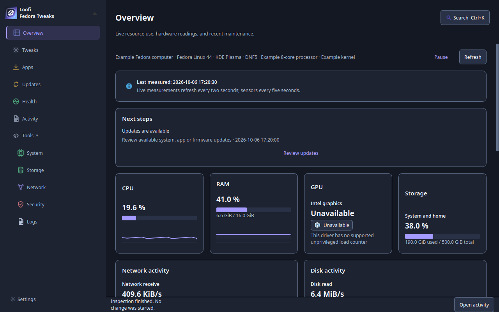

<p align="center">
  
</p>

<p align="center">
  <a href="https://github.com/loofiboss-bit/loofi-fedora-tweaks/releases/tag/v36.2.0"></a>
  <a href="https://github.com/loofiboss-bit/loofi-fedora-tweaks/actions/workflows/ci.yml"></a>
  <a href="https://copr.fedorainfracloud.org/coprs/loofitheboss/loofi-fedora-tweaks/"></a>
  <a href="LICENSE"></a>
</p>

<p align="center">
  <a href="#install">Install</a> •
  <a href="#what-it-does">What it does</a> •
  <a href="#my-fedora-configuration">My Fedora configuration</a> •
  <a href="#command-line">CLI</a> •
  <a href="#safety">Safety</a> •
  <a href="#documentation">Documentation</a>
</p>

<p align="center">
  
</p>

## What it does

Loofi Fedora Tweaks is a native PyQt6 control center and read-first CLI for
Fedora Linux, prioritizing **KDE Plasma 6** on **Fedora 44 and Fedora 45** while
preserving capability-aware support for **GNOME**, **Fedora Atomic**
(`rpm-ostree`), and **bootc** systems.

Start on **Overview** for a task-oriented summary of relevant next steps,
recorded maintenance, optional guides, **My Fedora configuration**, and a
collapsible live hardware monitor.

| Destination | Purpose |
| --- | --- |
| **Overview** | Recommended next steps, recent maintenance status, guides, **My Fedora configuration**, and collapsible live CPU, RAM, GPU, storage, network, temperature, and battery readings. Unavailable metrics explain why. |
| **Tweaks** | Browse and search **84** declarative controls (46 GNOME, 36 KDE Plasma, 2 shared), compare current vs target values, review built-in or personal profiles, apply with independent readback, and restore verified previous values. |
| **Apps** | Search local AppStream RPM catalogs and Flatpak remotes, inspect Flatpak metadata permissions, compare installations, review dependencies cleanly, and remove exact packages/refs safely. |
| **Updates** | Check and update System packages, Flatpaks, and Firmware in separate reviewed transactions, inspect upgrade readiness, and verify reboot outcomes. |
| **Health** | Start from a real user symptom, run bounded read-only diagnostics, inspect evidence, and apply one reviewed fix without blanket automation. |
| **Activity** | Track completed, interrupted, or reboot-pending runs with inline recovery banners, before/after verification evidence, and eligible restoration actions. |

Expand **Tools** in the sidebar footer group for **System**, **Storage**,
**Network**, **Security**, and **Logs**, or press `Ctrl+K` anywhere to jump to a
setting, profile, guide, or symptom without changing system state.

## What's new in v36.2.0 "Blueprint"

The published **[v36.2.0 Blueprint](https://github.com/loofiboss-bit/loofi-fedora-tweaks/releases/tag/v36.2.0)** release
(2026-11-18, Fedora COPR build `11350161` for `fedora-44-x86_64` and `fedora-45-x86_64`) builds on `v36.1.0 Blueprint`, `v35.0.0 Everyday`, and `v33.0.1 Concord`:

- **Fedora 45 & KDE Plasma 6 readiness:** Qualified Fedora 45 release policy (`FedoraReleasePolicy.fedora45_qualified()`), added everyday KDE Plasma 6 tweaks (`kde-touchpad-natural-scroll` and `kde-dolphin-browse-archives` across **84** cataloged controls), connected pre/post-upgrade Blueprint workflows in **Updates**, and added `--fedora-release {44,45}` support in the VM E2E orchestrator.
- **Qt/AT-SPI scroll stabilization & clean packaging:** Stabilized `QScrollArea` ownership across control-center views (`owns_scroll = True`) with active AT-SPI (`QT_LINUX_ACCESSIBILITY_ALWAYS_ON=1`) multi-route regression coverage and enforced COPR `%check` verification.
- **Cohesive UX & My Fedora configuration:** Task-oriented Overview with collapsible hardware monitor, clearer current-vs-target comparisons in Tweaks, side-by-side Blueprint diff summary and quick actions, inline Activity recovery banners, and contextual cross-page routing across Health, Updates, Tweaks, and Activity.
- **Architectural consolidation:** Retired legacy compatibility shims (`core/profiles/*`, `ui/logs_tab.py`, `ui/performance_tab.py`, `cli/action_plans.py`, `core/diagnostics/gaming_audit.py`), decomposed oversized hardware/shell modules, and cached static OS/CPU probes.

See the [v36.2.0 release notes](docs/releases/RELEASE-NOTES-v36.2.0.md),
[publication evidence](docs/reports/V36.2.0_RELEASE_PUBLICATION.md), and
[product definition](docs/PRODUCT.md) for full details and evidence boundaries.

### My Fedora configuration

**My Fedora configuration** lets you save named sets of installed RPM/Flatpak
applications and supported desktop settings as portable data-only
`loofi.setup/v1` JSON:

- **Read & export:** Snapshot selected apps and settings into your private local library or export data-only JSON (never commands, credentials, home files, or prior approvals).
- **Preview & compare:** Inspect every item before import, compare against fresh system observations with a side-by-side diff card, and choose target Flatpak installations or local repositories explicitly.
- **Reviewed execution & restart recovery:** Apply sources, applications, and desktop settings sequentially through existing Action Center reviews. Already-satisfied items and unrelated apps are left untouched; interrupted runs prompt a fresh comparison on restart.
- **CLI inspection:** `setup list`, `setup show SETUP_ID`, and `setup compare SETUP_ID` (with `--json`).

## Install

### Fedora COPR (`fedora-44-x86_64` and `fedora-45-x86_64`)

```bash
sudo dnf copr enable loofitheboss/loofi-fedora-tweaks
sudo dnf install loofi-fedora-tweaks
```

Launch **Loofi Fedora Tweaks** from your desktop menu or run `loofi-fedora-tweaks`.
Administrator authorization is requested through Polkit only when an explicit
system change requires it. Never run the GUI as `root`.

### Run from source

```bash
git clone https://github.com/loofiboss-bit/loofi-fedora-tweaks.git
cd loofi-fedora-tweaks
python3 -m venv .venv && source .venv/bin/activate
python -m pip install -e '.[dev]'
PYTHONPATH=loofi-fedora-tweaks python3 loofi-fedora-tweaks/main.py
```

## Command line

```bash
loofi-fedora-tweaks --cli info
loofi-fedora-tweaks --cli check
loofi-fedora-tweaks --cli tweaks list
loofi-fedora-tweaks --cli tweaks preset preview reduced-motion
loofi-fedora-tweaks --cli tweaks preset apply file-navigation --yes
loofi-fedora-tweaks --cli tweaks profile library compare focus privacy-basics
loofi-fedora-tweaks --cli apps list
loofi-fedora-tweaks --cli apps installed
loofi-fedora-tweaks --cli apps details app/org.mozilla.firefox/x86_64/stable --installation user
loofi-fedora-tweaks --cli updates check
loofi-fedora-tweaks --cli updates sources
loofi-fedora-tweaks --cli updates flatpaks --installation user
loofi-fedora-tweaks --cli updates prepare-upgrade --target 44
loofi-fedora-tweaks --cli updates restart-advice
loofi-fedora-tweaks --cli setup list
loofi-fedora-tweaks --cli setup compare SETUP_ID
loofi-fedora-tweaks --cli guides list
loofi-fedora-tweaks --cli activity list
loofi-fedora-tweaks --cli doctor
loofi-fedora-tweaks --cli support-bundle
```

Pass `--json` before the subcommand for machine-readable output.

## Safety

- **No arbitrary commands or shell:** Every action uses typed schemas and explicit argument vectors (`shell=False`) with bounded timeouts.
- **Standard Polkit escalation:** Privileged changes request authorization per transaction via `pkexec`; there is no background daemon, local web API, or persistent sudoers rule.
- **Independent verification & recovery:** Exit code `0` alone is never treated as success; probes verify the resulting host state and support verified value restoration where available.
- **No hidden automation:** Loofi never reboots, retries failed mutations, or modifies repositories unattended.

## Development

```bash
just test               # run test suite
just lint               # flake8
just typecheck          # mypy
just verify             # full quality gate + architecture + >= 85% coverage
just check-packaging    # build & inspect wheel/sdist manifest
just build-rpm          # build local RPM
```

See [CONTRIBUTING](CONTRIBUTING.md), [ARCHITECTURE](ARCHITECTURE.md), and the
[design system](DESIGN.md).

## Documentation

[User guide](docs/USER_GUIDE.md) · [Getting started](docs/BEGINNER_QUICK_GUIDE.md) ·
[Tweaks catalog (84)](docs/TWEAKS.md) · [Troubleshooting](docs/TROUBLESHOOTING.md) ·
[Roadmap](ROADMAP.md) · [Changelog](CHANGELOG.md) · [Security policy](SECURITY.md)

## License

MIT
