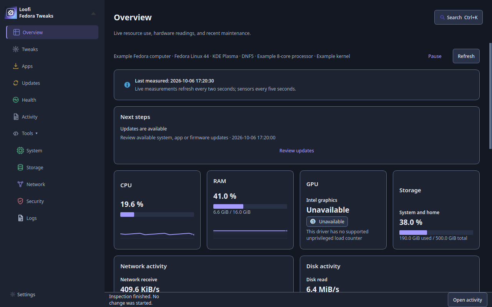

# Loofi Fedora Tweaks

<p align="center">
  
</p>

<p align="center">
  <strong>Make Fedora feel like your computer.</strong><br>
  Understand your system, change supported settings, and verify results on Fedora.
</p>

<p align="center">
  <a href="https://github.com/loofiboss-bit/loofi-fedora-tweaks/actions/workflows/ci.yml"></a>
  <a href="https://copr.fedorainfracloud.org/coprs/loofitheboss/loofi-fedora-tweaks/"></a>
  
  <a href="LICENSE"></a>
</p>



## What it does

Start with **Overview** for live resources, available hardware readings, and
recorded maintenance. Then choose the task you want to perform.

| | |
|---|---|
| **Overview** | CPU, memory, GPU, storage, network, temperatures, and battery where supported. Unavailable readings explain why. |
| **Tweaks** | Search a setting, check its current value, review a desktop preset, change it, and verify it. Restore a previous value where supported. |
| **Apps** | Install trusted applications, inspect installed apps and Flatpak metadata permissions, and review scoped removal. |
| **Updates** | Update system packages, Flatpaks, and firmware independently. |
| **Health** | Start from a symptom, inspect the evidence, and apply one reviewed fix. |

The published **32.8.0 Guide** release adds four resumable everyday workflows,
searchable guide discovery, saved progress and read-only CLI inspection. Each
guide opens existing review and verification flows; opening a step never starts
a check or change. See the [32.8.0 release notes](docs/releases/RELEASE-NOTES-v32.8.0.md).

The current working tree contains the local **v33.0.0 candidate**. Overview
puts core resource readings first; Tweaks groups Settings and Profiles; Apps
separates Catalog, Installed, and Sources; and operation results remain linked
to their origin across navigation. The candidate is unpublished and has no
release date. KDE on traditional Fedora with DNF5 is the first qualification
target; GNOME and Atomic support remains limited to workflows with evidence.
See the [roadmap](ROADMAP.md) for verification status and evidence boundaries.

The release builds on Routine's installation comparisons, Health storage guide,
manual DNF5 restart advice and saved profile comparisons; Personal's broader
RPM application discovery, editable profile copies and reviewed KDE controls;
and Companion's profile library, explained Flatpak access, Health comparisons,
screen-sharing diagnostics and Fedora upgrade preparation. The dated
[qualification reports](docs/GUIDE_VERIFICATION.md) record evidence collected
for those releases; they do not qualify later changes.
Open **Tools** in the sidebar for System, Storage,
Network, Security, and Logs. See the [product definition](docs/PRODUCT.md) for
what is, and is not, in scope.

## Install

```bash
pkexec dnf copr enable loofitheboss/loofi-fedora-tweaks
pkexec dnf install loofi-fedora-tweaks
```

Then launch **Loofi Fedora Tweaks** from the desktop menu, or run
`loofi-fedora-tweaks`. Authorization is requested only when a change needs it.
Never run the application as root.

### Run from source

```bash
git clone https://github.com/loofiboss-bit/loofi-fedora-tweaks.git
cd loofi-fedora-tweaks
python3 -m venv .venv && source .venv/bin/activate
python -m pip install -e '.[dev]'
PYTHONPATH=loofi-fedora-tweaks python3 loofi-fedora-tweaks/main.py
```

## Command line

```bash
loofi-fedora-tweaks --cli tweaks list
loofi-fedora-tweaks --cli tweaks preset list
loofi-fedora-tweaks --cli tweaks preset preview reduced-motion
loofi-fedora-tweaks --cli tweaks preset apply file-navigation --yes
loofi-fedora-tweaks --cli apps list
loofi-fedora-tweaks --cli apps permissions app/org.mozilla.firefox/x86_64/stable --installation user
loofi-fedora-tweaks --cli apps details app/org.mozilla.firefox/x86_64/stable --installation user
loofi-fedora-tweaks --cli apps unused --installation user
loofi-fedora-tweaks --cli updates check
loofi-fedora-tweaks --cli updates sources
loofi-fedora-tweaks --cli updates diagnose --source flatpak
loofi-fedora-tweaks --cli tweaks profile library list
loofi-fedora-tweaks --cli apps access app/org.mozilla.firefox/x86_64/stable --installation user
loofi-fedora-tweaks --cli updates prepare-upgrade --target 44
loofi-fedora-tweaks --cli apps compare org.mozilla.firefox
loofi-fedora-tweaks --cli updates restart-advice
loofi-fedora-tweaks --cli tweaks profile library compare focus privacy-basics
```

Add `--json` before a command for machine-readable output.

## Safety

- The interface never runs arbitrary commands. Commands are allow-listed,
  list-based, time-limited, and never use a shell.
- Privileged changes go through the desktop's standard authorization agent.
- Every change is checked after it is applied. Previous values can be restored
  where verified history supports it; other actions show their recovery guidance.
- Nothing reboots, retries, or applies changes remotely on its own.

## Development

```bash
just test        # test suite
just lint        # flake8
just typecheck   # mypy
just verify      # all of the above plus coverage
```

See [CONTRIBUTING](CONTRIBUTING.md), [ARCHITECTURE](ARCHITECTURE.md), and the
[design system](DESIGN.md).

## Documentation

[User guide](docs/USER_GUIDE.md) · [Getting started](docs/BEGINNER_QUICK_GUIDE.md) ·
[Troubleshooting](docs/TROUBLESHOOTING.md) · [Roadmap](ROADMAP.md) ·
[Changelog](CHANGELOG.md)

## License

MIT

### Everyday workflows

Overview prioritizes recorded next steps. Updates restores pending verification
after reopening without repeating an update. Tweaks supports [portable profiles](docs/TWEAK_PROFILES.md),
reviewed desktop presets, and a focused check for one setting. Apps lists installed
Flatpaks by installation, shows metadata permissions, and preserves app data when
reviewing removal. Health provides read-only sound and Bluetooth diagnostics. See
[qualification](docs/EVERYDAY_VERIFICATION.md) for separately dated local evidence.
