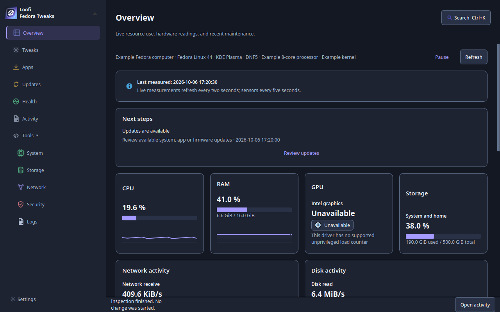

# Loofi Fedora Tweaks Wiki — v36.2.0 "Blueprint"

Loofi Fedora Tweaks brings application management, desktop settings, **My Fedora
configuration**, symptom diagnostics, and verified operation history together,
prioritizing **KDE Plasma 6** on **Fedora 44 and Fedora 45** with DNF5 while
preserving capability-aware support for GNOME, Fedora Atomic (`rpm-ostree`),
and `bootc`.

**Current Release:** [v36.2.0 Blueprint](https://github.com/loofiboss-bit/loofi-fedora-tweaks/releases/tag/v36.2.0) (published 2026-11-18).
Save and compare portable `loofi.setup/v1` app and tweak blueprints, inspect
84 declarative controls with current-vs-target comparison, manage RPM/Flatpak
apps cleanly, review independent updates and upgrade preparation, and track
verified operations and recovery banners in Activity.

See [v36.2.0 release notes](https://github.com/loofiboss-bit/loofi-fedora-tweaks/blob/master/docs/releases/RELEASE-NOTES-v36.2.0.md)
and [publication evidence](https://github.com/loofiboss-bit/loofi-fedora-tweaks/blob/master/docs/reports/V36.2.0_RELEASE_PUBLICATION.md).
Publication is verified on GitHub and Fedora COPR ([build 11350161](https://copr.fedorainfracloud.org/coprs/loofitheboss/loofi-fedora-tweaks/build/11350161/) for
`fedora-44-x86_64` and `fedora-45-x86_64`).

**Previous releases:** [v36.1.0 Blueprint](https://github.com/loofiboss-bit/loofi-fedora-tweaks/releases/tag/v36.1.0), [v35.0.0 Everyday](https://github.com/loofiboss-bit/loofi-fedora-tweaks/releases/tag/v35.0.0), and [v33.0.1 Concord](https://github.com/loofiboss-bit/loofi-fedora-tweaks/releases/tag/v33.0.1).



## Product principles

1. Browsing, search, and diagnosis do not modify the host.
2. Every persistent mutation uses the internal orchestrator with fresh
   preflight, bounded execution, and independent verification.
3. Traditional Fedora, Atomic, bootc, and unknown backends remain distinct;
   unsupported mutations fail closed.
4. There is no background daemon, web API, arbitrary shell execution,
   automatic retry, rollback, or reboot.
5. Physical environment claims require physical evidence; unrun environments
   remain `unverified`.

Physical GNOME, KDE, Atomic, Polkit, keyboard, Orca, and scaling checks remain
unverified; automated qualification is recorded in the release notes.

## The six destinations

| Destination | Purpose |
| --- | --- |
| **[Overview](GUI-Tabs-Reference#overview)** | CPU, memory, GPU, storage, recorded state and guidance |
| **[Tweaks](GUI-Tabs-Reference#tweaks)** | Settings and Profiles, scope, review, verification and restore |
| **[Apps](GUI-Tabs-Reference#apps)** | Catalog, Installed, Sources and exact selected-app review |
| **[Updates](GUI-Tabs-Reference#updates)** | Independent System, Flatpak and Firmware operations |
| **[Health](GUI-Tabs-Reference#health)** | Symptom diagnostics and reviewed recovery |
| **[Activity](GUI-Tabs-Reference#activity)** | Recorded outcomes and eligible restoration |

Tools contains advanced destinations; Settings stays in the sidebar footer.

## Documentation

- **[Getting Started](Getting-Started)** — installation and first workflows
- **[GUI Reference](GUI-Tabs-Reference)** — the five task destinations
- **[CLI Reference](CLI-Reference)** — bounded read-first CLI commands
- **[Atomic Fedora](Atomic-Fedora-Support)** — immutable deployment behavior
- **[Troubleshooting](Troubleshooting)** — diagnostic and recovery runbooks
- **[Configuration](Configuration)** — XDG state and privacy boundaries
- **[Security Model](Security-Model)** — authorization and execution boundary
- **[Testing](Testing)** — automated and physical qualification rules
- **[Screenshots](Screenshots)** — current interface gallery
- **[Changelog](Changelog)** — release history

## Install

```bash
pkexec dnf copr enable loofitheboss/loofi-fedora-tweaks
pkexec dnf install loofi-fedora-tweaks
loofi-fedora-tweaks
```

Source code and releases are available in the
[GitHub repository](https://github.com/loofiboss-bit/loofi-fedora-tweaks).
Packages are published in the
[Fedora COPR project](https://copr.fedorainfracloud.org/coprs/loofitheboss/loofi-fedora-tweaks/).
